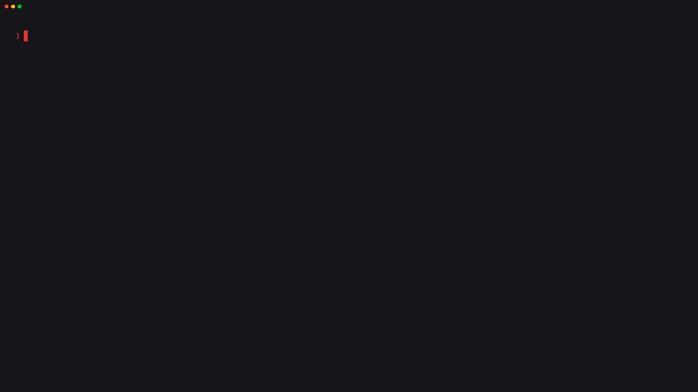
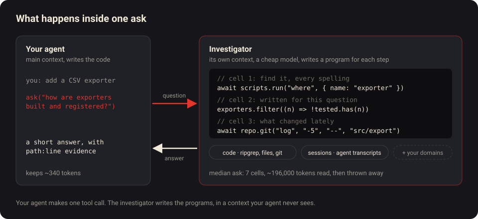
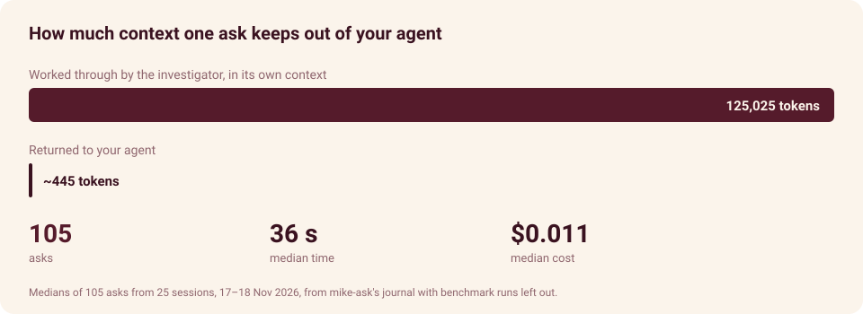

<h1 align="left"><a href="https://github.com/temet-ai/ask-kit"></a></h1>

Most of a coding agent's context goes on finding things out: searching, opening files, following
calls, checking what was tried before. All of it stays in the context and crowds out the work
the agent was asked to do.

ask-kit moves that work out of the agent's context. It gives the agent one tool, `ask`. The
agent asks a question in plain words, and a cheap investigator works it out in its own context.
The agent gets back a short answer with the evidence it's based on, and its own context stays
free for the change it is making.

```
you:   add a CSV exporter like the other ones

agent → ask: how are the exporters built and registered, and which tests cover them?

ask   → Exporters implement Exporter in src/export/base.ts:12 and are registered in
        src/export/index.ts:30. JsonExporter (src/export/json.ts) is the closest model;
        tests are in test/export/*.test.ts.
```

(This is an example of what an answer looks like.
[Context, time and cost per ask](#context-time-and-cost-per-ask) has real numbers.)

A real ask from the shell, about this repository's code, with a line per program the investigator
runs and then a follow-up:



`ask` is an [MCP](https://modelcontextprotocol.io) server, so any agent that takes MCP servers
can use it: Claude Code, Codex, GitHub Copilot CLI, Gemini CLI, opencode.

**[Read the guide](docs/user-guide/README.md)**: how to use it, use cases, models, tuning. Also [read it on temet.ai](https://temet.ai/docs/ask-kit/).

## How the investigator answers

For each step of a question, the investigator writes a small JavaScript program and runs it in a
REPL. The program does whatever the step needs: loops, filters, joins, counts, comparisons,
parsing. It is written fresh for that question. A domain gives the programs access to the data.
What a program prints is all that returns to the investigator's model. Code mode, recursive
language models and Claude Code subagents each do part of this;
[How ask-kit relates to them](docs/user-guide/code-mode.md) goes through each.



Each thing `ask` can answer about is a **domain**. ask-kit comes with two, as a starting point:

- **code**: the repository the agent is working in, cited as `path:line`.
- **sessions**: your past agent sessions, from the transcripts Claude Code, Codex, Copilot CLI,
  Gemini CLI and opencode already save. It reads them where they are, with no proxy or database.

[Add your own](docs/user-guide/domains.md) for anything else your agent keeps digging through.

## Set it up

Paste one line into the agent you already use, on Linux, macOS or Windows:

```
Read https://github.com/temet-ai/ask-kit/blob/main/AGENTS.md, then set up ask-kit for me.
```

The agent installs ask-kit and asks you a few questions. The main one is which model does the
digging:
- an API key (cheapest and fastest),
- a subscription you already pay for (Claude Code, Codex, Copilot),
- or a local model.

It shows what it will change before it changes anything. Restart your agents afterwards, and
they call `ask` by themselves when they need to find something out.

In Claude Code you can install it as a plugin instead. Its npm packages come with the install, and
it needs Node.js 22.13 or newer:

```
/plugin marketplace add temet-ai/ask-kit
/plugin install ask-kit@temet-ai
```

The plugin brings the `ask` tool, the skills and the tuner agent. Then ask Claude to set up
ask-kit, and the ask-kit-setup skill asks you the same questions. The plugin covers Claude Code
only; `ask-kit init` and `ask-kit setup` leave Claude Code alone while it is installed.

Without an agent: `npm install -g --allow-git=root github:temet-ai/ask-kit`, then `ask-kit init`
and `ask-kit setup`. It needs Node.js 22.13 or newer and git. If npm answers `EACCES`, add
`--prefix ~/.local` to the install command.
[Set it up](docs/user-guide/setup.md) has the details.

## Context, time and cost per ask

How much context one ask keeps out of the calling agent. These are medians from mike-ask, the
proof of concept ask-kit grew from:



ask-kit itself, on 18 Nov 2026, on one machine with about 1,500 sessions on disk:

| Question | Investigator | Time | Cost |
|---|---|---|---|
| What did a Codex session find and change | glm-5.3-flash (OpenRouter) | 16 s | $0.0022 |
| Which sessions worked on X in the last week | glm-5.3-flash, domain picked by the router | 53 s | $0.0083 |
| Follow-up on that (`continue: true`) | glm-5.3-flash | 17 s | $0.0035 |
| Which Copilot session did a piece of work, under which ticket | Claude Code, haiku | 23 s | $0.0025 |
| same | Codex (ChatGPT plan) | 36 s | in the plan |
| same | Copilot CLI | 134 s | Copilot premium requests |
| How does routing work in this repo | deepseek-v4.1-flash (code) | 110 s | $0.0033 |

## What's in this repository

| Folder | What |
|---|---|
| `bin/`, `src/` | the `ask-kit` command, the MCP server, the investigator loop, the transcript readers |
| `domains/` | the two built-in domains, `code` and `sessions`: instructions, scripts and the typed description of what they can reach |
| `bundle/` | what `ask-kit init` installs into each agent: three skills, the `ask-kit-tuner` agent and the when-to-ask rule. They are templates, and `init` fills in this machine's paths. |
| `docs/user-guide/` | the guide, also at temet.ai/docs/ask-kit |

## Status

Early. Tested on Linux with real transcripts. Fixtures for all five transcript formats run in CI
on Linux, macOS and Windows. The Gemini CLI reader and the opencode and Gemini install formats
follow their docs and haven't yet been tried on a real install. There are no releases yet, so
you install from `main`.

ask-kit started as mike-ask, a proof of concept that answers from what
[mike](https://github.com/temet-ai/mike) records of every Claude Code session. ask-kit is the
general version. It needs no mike and no server.

## What it stores and sends

It sends your question, and the excerpts the investigator reads, to the model you chose. There's
no telemetry. Everything it keeps is under `~/.config/ask-kit/` and `~/.local/state/ask-kit/`,
including the clipped prompts `ask-kit gaps` caches from your transcripts and, for the one in 20
action answers that a model checks in the background, both answers.
[What it stores and sends](docs/user-guide/privacy.md) has the full list.

## Contributing

Bug reports and small fixes are welcome; see [CONTRIBUTING.md](CONTRIBUTING.md). Report security
problems privately, as [SECURITY.md](SECURITY.md) says.

## Licence

MIT, see [LICENSE](LICENSE). Third-party licences are in
[THIRD-PARTY-NOTICES.md](THIRD-PARTY-NOTICES.md).
