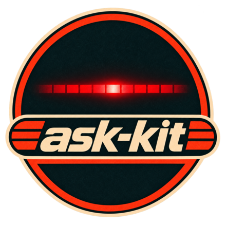
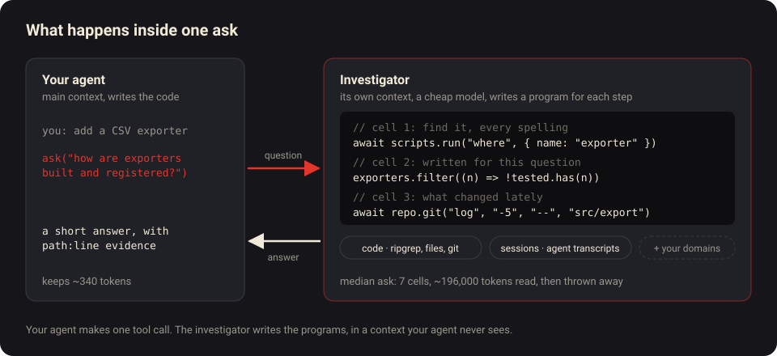
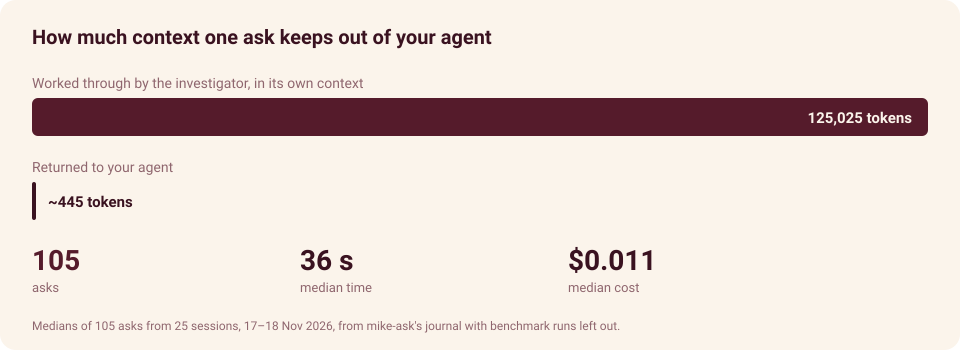

# ask-kit



Most of a coding agent's context goes on finding things out: searching, opening files, following
calls, checking what was tried before. All of it stays in the context, and it crowds out the
real work.

ask-kit moves that work out of the agent's context. It gives the agent one tool, `ask`. The agent
asks a question in plain words, and a cheap investigator works it out in its own context. The
agent gets back a short answer, with the evidence it's based on. Your main agent keeps its
context for the heavy lifting: designing, writing and fixing code.

```
you:  add a CSV exporter like the other ones

agent → ask: how are the exporters built and registered, and which tests cover them?

ask   → Exporters implement Exporter in src/export/base.ts:12 and are registered in
        src/export/index.ts:30. JsonExporter (src/export/json.ts) is the closest model;
        tests are in test/export/*.test.ts.
        [code · glm-5.3-flash · 21s · $0.0031]
```

The agent read three lines instead of a dozen files, and starts the change from there.
(The exchange above is an example of what an answer looks like.)

## The work happens in code

The investigator doesn't work by calling tools one at a time, MCP or otherwise. It writes a small
JavaScript program for each step of the question, and runs it in a REPL. The program has
whatever the step needs: loops, filters, joins, counts, comparisons, parsing. A domain only gives
it a way in to the data. The logic is written fresh for the task. One program does what would
otherwise take a dozen tool calls, and only what it prints comes back. Common questions already
have scripts, so it can start from one of those.



Everything it reads stays in its context and is thrown away afterwards. Your agent only gets
the answer.



[How it works](how-it-works.md) goes into more detail.

Each kind of thing `ask` can answer about is a **domain**: an investigator with an API and
instructions for that thing. ask-kit comes with two, and they are meant as a starting point:

- **code**: the repository the agent is working in, cited as `path:line`.
- **sessions**: your past agent sessions, from the transcripts Claude Code, Codex, Copilot CLI,
  Gemini CLI and opencode already save.

[Add your own](domains.md) for anything else your agent keeps digging through: a database, logs,
a service, a docs folder.

## Start

1. Paste this into the agent you already use (Claude Code, Codex, Copilot CLI, Gemini CLI or
   opencode):

   ```
   Read https://github.com/temet-ai/ask-kit/blob/main/AGENTS.md, then set up ask-kit for me.
   ```

   It installs ask-kit and asks you a few questions. The main one is which model does the
   digging.
2. Restart your agents.
3. Give your agent a task. It calls `ask` by itself when it needs to find something out. You
   can also ask directly: `ask where the config file is read`.

## Pages

- [Use it](asking.md): what to ask, reading answers, follow-ups. **Start here.**
- [Set it up](setup.md): what setup does, and how to change it later.
- [Choose the model](models.md): an API key, a subscription you already pay for, or a local model.

Use cases:

- [Write code with it](use-coding.md)
- [Search code and past work](use-searching.md)
- [Pick up where you left off](use-resuming.md)
- [Make it better](tuning.md): fix the questions it answers badly.

More:

- [Domains](domains.md): teach `ask` about something new.
- [How it works](how-it-works.md)
- [Command line and files](command-line.md)
- [What it stores and sends](privacy.md)
- [Troubleshooting](troubleshooting.md)

## Status

Early. It has been used on one Linux machine. CI runs on Linux, macOS and Windows. There are no
releases yet, so you install from `main`.

ask-kit started as mike-ask, a proof of concept that answers from what
[mike](https://github.com/temet-ai/mike) records of every Claude Code session. ask-kit is the
general version: it needs no mike and no server, reads what your agents already save, and can
be given any domain.
