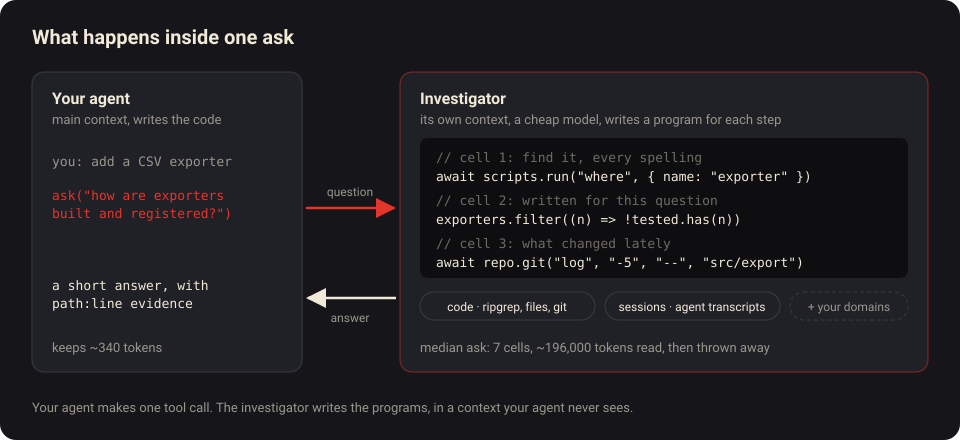

# How it works

Your agent makes one tool call and gets back one answer. Everything in between happens in the
investigator's own context, which your agent never sees.



## Programs, not tool calls

Agents usually work through tools, MCP or built in, one call at a time: search, read the result,
search again, open a file. Every step is a round trip, and every result lands in the context.

The investigator writes a program instead. For each step of the question it writes a small piece
of JavaScript and runs it in a REPL. The program does whatever the step needs: it loops over
files, joins one search with another, counts, compares, parses and filters. Then it prints only
the result. These programs are written for the question in front of it, not picked from a fixed
menu.

For "which exporters have no test, and are they all registered?" it might write:

```js
const name = (f) => f.split("/").pop().replace(/(\.test)?\.ts$/, "");
const exporters = (await repo.files("src/export/*.ts")).map(name)
  .filter((n) => n !== "index" && n !== "base");
const tested = new Set((await repo.files("test/export/*.test.ts")).map(name));
const registry = repo.read("src/export/index.ts").text;

exporters.map((n) => ({ exporter: n, tested: tested.has(n), registered: registry.includes(n) }));
```

That is one step. Done with tools, it would be a file listing, a second listing, a file read and
a comparison done in the model's head, each in its own round trip.

What the programs can reach comes from the domains:

- `repo` for code: `rg` (ripgrep), `files`, `read`, and some git commands that only read,
- `history` for your past sessions, across every agent's transcripts,
- `scripts` for ready-made programs for common questions,
- helpers such as `table`, `top`, `groupBy` and `countBy`,
- and whatever a domain you add provides.

Each domain describes what it provides in a typed file, `api.d.ts`.
[Domains](domains.md) shows how to write one.

## Scripts for the common questions

| Domain | Scripts |
|---|---|
| code | `where`, `knobs`, `history`, `outline`, `overview` |
| sessions | `find-sessions`, `session-digest`, `grep`, `session-tools`, `session-changes`, `recent` |

When the investigator writes something useful by hand, it can save it as a draft script.
[Make it better](tuning.md) shows how to turn a draft into a script.

## One tool, many investigators

Each domain has its own investigator. A router picks one from the question, with one short call
to the cheap model or with keyword rules. Your agent can choose one itself with `about`.

## Warm once, then fork

The instructions, the API and the scripts are the same for every question, so they are loaded
once:

- With Claude Code or Codex as the investigator, ask-kit starts one session with them loaded
  and copies it for each question.
- With an API, the provider caches them.

If you edit the instructions, a script or the API, the next question loads them again. Nothing
needs restarting.

## Follow-ups keep their state

The REPL's variables are saved after every cell. A follow-up (`continue: true`) restores them,
so the investigator carries on from what it found. Each of your agent's sessions has its own
saved state.

## The journal

Every ask and every cell is logged under `~/.local/state/ask-kit/` with time, cost, steps and the
scripts it used. `ask-kit report` reads it, and it's how you [make it better](tuning.md).

## It only reads

Transcripts, files, ripgrep, and git commands that only read. When an agent CLI is the
investigator, that CLI's own tools are turned off or limited to reading.
