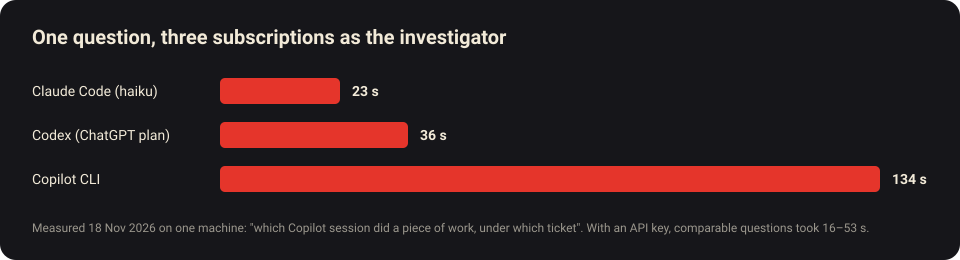

# Choose the model

The investigator is the model that answers each question. It has to be cheap and fast, and good
at writing small pieces of JavaScript. Setup offers what this machine already has.

| Kind | Cost | Speed | Answers |
|---|---|---|---|
| API key (suggested) | about a third of a cent a question | fastest | good |
| Subscription you already have | nothing extra | slower | good |
| Local model | free, and nothing leaves the machine | depends on your hardware | worse |

## API key

ask-kit works with any OpenAI-compatible chat API. The provider caches the part that is the same
for every question, so each question pays only for its own work.

| Provider | Key it looks for | Suggested models |
|---|---|---|
| OpenRouter | `OPENROUTER_API_KEY` | `z-ai/glm-5.3-flash`, `deepseek/deepseek-v4.1-flash-1017`, `anthropic/claude-haiku-5.5` |
| OpenAI | `OPENAI_API_KEY` | `gpt-6-mini`, `gpt-6` |
| Anthropic | `ANTHROPIC_API_KEY` | `claude-haiku-5-5`, `claude-sonnet-5-5` |
| Google Gemini | `GEMINI_API_KEY` | `gemini-4-flash` |
| DeepSeek | `DEEPSEEK_API_KEY` | `deepseek-chat` |
| Another endpoint | you say | you say |

`ask-kit doctor` checks that the model ids exist at the provider.

## Subscription

- **Claude Code** (`haiku` or `sonnet`), or **Codex** (a ChatGPT plan): each question takes a few
  seconds more to start.
- **Copilot CLI**: slower still. Each question uses premium requests.



Sign the CLI in once by hand first. Its questions show up in its history.

## Local model

Ollama or LM Studio. Small models make more mistakes here, because the work is writing a correct
small program for each step of a question they haven't seen before.

## Change or mix models

```
Read ~/.config/ask-kit/AGENTS.md, then switch ask's default model to codex.
Read ~/.config/ask-kit/AGENTS.md, then answer code questions with deepseek.
```

To try a model on one question without changing anything:
`ask-kit ask --backend <name> "<question>"`.
